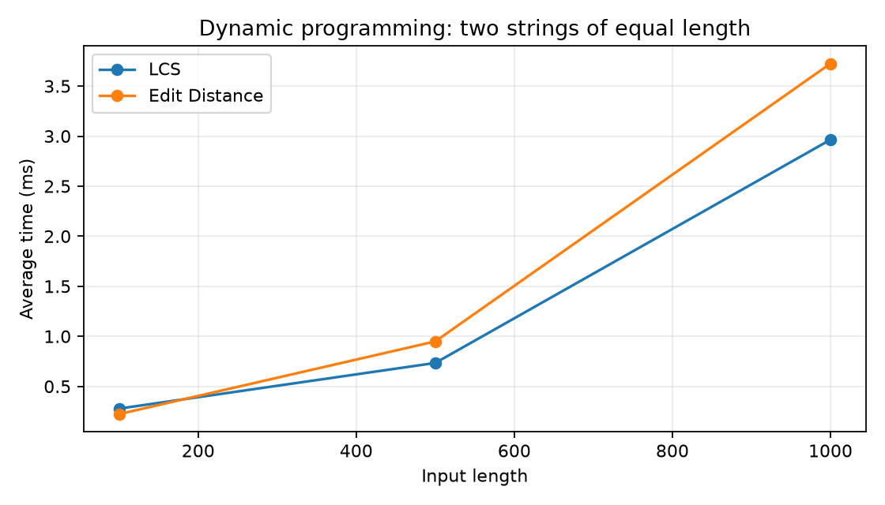
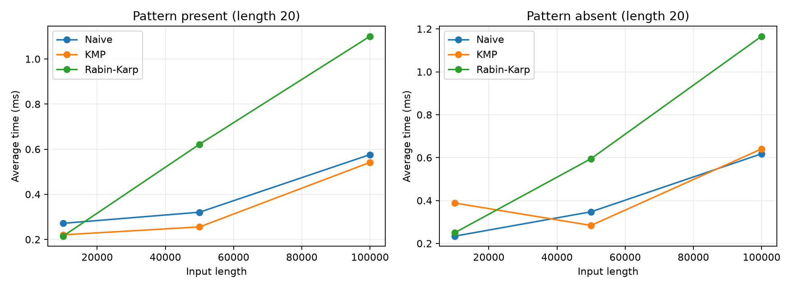
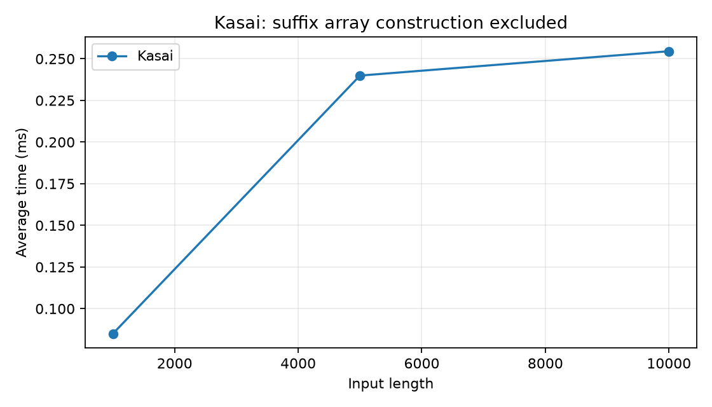

# Assignment 4 — Text Analysis

A Java project comparing string algorithms: LCS, Levenshtein distance, naive string matching, KMP, Rabin–Karp, and Kasai's algorithm. The code uses no third-party Java libraries. This README serves as the full report.

## 1. Running the Project

JDK 8 or later is required. A JRE alone is not enough because compilation requires `javac`. Run these commands from the project root:

```text
mkdir out
javac -encoding UTF-8 -d out src/*.java
java -cp out AlgorithmTests
java -cp out Benchmark
```

In PowerShell, if the JDK is installed but is not on PATH, you can specify its location. The following path was used on the computer where the experiments were run:

```powershell
$jdkPath = "$env:USERPROFILE\.jdks\openjdk-25.0.2\bin"
New-Item -ItemType Directory -Force out | Out-Null
& "$jdkPath\javac.exe" -encoding UTF-8 -d out src\*.java
& "$jdkPath\java.exe" -cp out AlgorithmTests
& "$jdkPath\java.exe" -cp out Benchmark
```

The generated plots are already available in `results`. To rebuild them, install Python and matplotlib:

```text
python -m pip install -r requirements.txt
python scripts/plot_results.py
```

The script also updates the results table below. After taking new measurements, review the discussion manually because it describes the saved benchmark run.

Project structure:

```text
src/DynamicProgramming.java  — LCS and Edit Distance
src/StringMatching.java     — Naive, KMP, Rabin–Karp
src/Kasai.java              — LCP and helper suffix array construction
src/AlgorithmTests.java     — tests
src/Benchmark.java          — data generation and measurements
scripts/plot_results.py     — plots and report table
results/                   — CSV files, plots, and environment details
```

## 2. Algorithms and Correctness

### LCS — Longest Common Subsequence

A subsequence preserves character order, but its characters do not have to be consecutive. For example, `ac` is a subsequence of `abc`. The method returns only the LCS length.

Let `dp[i][j]` be the LCS length for the first `i` characters of string `a` and the first `j` characters of string `b`.

```text
dp[0][j] = 0
dp[i][0] = 0

if a[i-1] == b[j-1]:
    dp[i][j] = dp[i-1][j-1] + 1
else:
    dp[i][j] = max(dp[i-1][j], dp[i][j-1])
```

An empty string has no nonempty common subsequence with another string. If the last characters match, they can extend the answer for the shorter prefixes. If they differ, a common subsequence cannot use both as its final character, so the last character of at least one string must be excluded. We choose the better of these two options. The table is filled from shorter prefixes to longer ones, so all required values are already known.

### Edit Distance — Levenshtein Distance

This is the minimum number of insertions, deletions, and substitutions needed to transform one string into another. Each operation costs 1; a matching character costs 0.

```text
dp[i][0] = i
dp[0][j] = j
cost = 0 if a[i-1] == b[j-1], otherwise 1
dp[i][j] = min(
    dp[i-1][j] + 1,       // delete
    dp[i][j-1] + 1,       // insert
    dp[i-1][j-1] + cost   // substitute or keep
)
```

To obtain an empty string, every character must be deleted. To create a string from an empty one, every character must be inserted. In the general case, all possible final operations are considered. Each option uses the optimal answer for smaller prefixes. The minimum of these options gives the optimal answer for the current pair of prefixes.

### Naive String Matching

The algorithm checks every valid starting position. At each position, characters are compared from left to right until a mismatch or the end of the pattern. If all characters match, the index is added to the list. Every possible position is checked, so no occurrence is missed.

### KMP

First, the `lps` array is constructed. The value `lps[i]` is the length of the longest proper prefix of `pattern[0..i]` that is also a suffix of that substring. A proper prefix is shorter than the entire substring.

On a mismatch, KMP reuses the match found so far by setting `j = lps[j-1]`. This length indicates how much of the pattern can remain matched. If this candidate also fails, the algorithm moves to the next shorter prefix. The text index never moves backward. This avoids checking entire sections of text again. After a complete match, `lps` is also used so that overlapping occurrences are preserved.

### Rabin–Karp

A polynomial hash is computed for the pattern and the current text window. The base is 257, and the modulus is 1,000,000,007. Variables of type `long` safely hold intermediate calculations with these constants.

When the window shifts, the contribution of its first character is removed, the remaining value is multiplied by the base, and the new character is added. Updating the hash therefore takes O(1) time.

```text
nextHash = ((oldHash - firstChar * base^(m-1)) * base + nextChar) mod modulus
```

The code normalizes the remainder after subtraction to a nonnegative value. Equal strings always have equal hashes, but different strings may also have equal hashes. Therefore, a character-by-character check is performed whenever the hashes match. Collisions can slow down the search but cannot produce false results. The tests use modulus 2 to force frequent collisions.

### Kasai's Algorithm

A suffix is the part of a string from a given position to its end. The suffix array `sa` stores the starting positions of all suffixes in lexicographic order.

Here, `lcp[0] = 0`, and `lcp[r]` is the length of the common prefix of the suffixes starting at `sa[r-1]` and `sa[r]`.

A worked example for `banana`:

| r | sa[r] | Suffix | lcp[r] |
|---:|---:|---|---:|
| 0 | 5 | a | 0 |
| 1 | 3 | ana | 1 |
| 2 | 1 | anana | 3 |
| 3 | 0 | banana | 0 |
| 4 | 4 | na | 0 |
| 5 | 2 | nana | 2 |

First, the inverse array `rank` is built to record each suffix's position in `sa`. The suffixes are then visited in the order of their starting positions in the original string. Each is compared with its preceding neighbor in `sa`.

If two suffixes share their first `h` characters, removing their first characters leaves at least `h-1` common characters. The new suffix's immediate predecessor in the sorted array shares a prefix at least this long. Comparison can therefore continue from `h-1` without rechecking the beginning. The first suffix in `sa` has no predecessor, so `h` is reset to 0.

The counter `h` normally decreases by at most 1 per iteration. The reset for `rank == 0` can occur only once and is at most n. Thus, the total number of increments of `h` is also O(n). Including the construction of `rank`, the algorithm runs in O(n) time.

## 3. Design Decisions and Assumptions

- Indices are zero-based. All occurrences, including overlapping ones, are returned in order.
- An empty pattern matches every string boundary, from 0 to n inclusive. If both strings are empty, the result is `[0]`.
- If the pattern is longer than the text, an empty list is returned.
- Input strings must not be `null`. Comparisons are case-sensitive.
- A Java `char` is a UTF-16 code unit. For the alphabet `abcd`, this corresponds to one character; some emoji occupy two positions per visible character.
- Dynamic programming uses the full table. This is easier to explain, although memory could be reduced by keeping only the previous and current rows.
- Kasai's algorithm receives a valid, already sorted suffix array with no duplicate indices. Its length is checked, but the input array is not fully validated.
- For the experiments, the suffix array is built by sorting indices using direct suffix comparisons. This is an allowed helper method, not an implementation of fast suffix array construction. Its worst-case complexity is O(n² log n) time and O(n) auxiliary space. Its running time is excluded from the Kasai measurements.

## 4. Theoretical Complexity

For dynamic programming, n and m are the lengths of the two strings. For string matching, n is the text length and m is the pattern length. The search entries in the table assume `1 <= m <= n`; `q = n-m+1` is the number of possible starting positions. Space estimates exclude the input and the returned result.

| Algorithm | Main operation | Preprocessing | Best case | Worst case | Auxiliary space | Explanation |
|---|---|---|---|---|---|---|
| LCS | Match: diagonal + 1; otherwise max of two neighbors | O(n+m) for boundaries, included in total time | O(nm) | O(nm) | O(nm) | All n·m cells are filled regardless of the characters |
| Edit Distance | Minimum of deletion, insertion, and substitution | O(n+m) for boundaries, included in total time | O(nm) | O(nm) | O(nm) | A constant number of operations per cell |
| Naive | Character-by-character check at every position | O(1) | Θ(q), immediate mismatch | O(qm) | O(1) | Up to m comparisons per position |
| KMP | Transitions using lps | Θ(m) time, O(m) space | Θ(n) search | O(n) search; O(n+m) total | O(m) | The text is not rescanned from the beginning of a match |
| Rabin–Karp | Rolling hash and verification of hash matches | Θ(m) | Θ(q) search without long match verifications | O(qm) search; O(m+qm) total | O(1) | Each hash match may require m comparisons |
| Kasai | Compare adjacent suffixes, carrying over h-1 | Θ(n) for rank, included in total time | Θ(n) | Θ(n) | O(n) | The total number of increments of h is linear |

For LCS and Edit Distance, a more precise bound accounting for empty strings and table allocation is O((n+1)(m+1)).

For Rabin–Karp, expected running time is often written as O(n+m) when collisions are rare and there are few actual matches. A more precise bound for this implementation is O(n+m+(k+c)m), where k is the number of actual matches and c is the number of false hash matches. Repetitive text can contain many actual matches, and verifying them can itself lead to quadratic time. A fixed hash does not guarantee linear time for every input.

The list of k matching positions requires O(k) space in addition to the table estimates. For an empty pattern, all three search methods take Θ(n+1) time and space for the result. For a pattern longer than the text, they return in O(1) time. The returned LCP array takes O(n) space.

## 5. Correctness Testing

Tests run through a regular `main` method without JUnit. Failed checks throw `AssertionError`, so the `-ea` flag is not required.

The following cases are covered:

- LCS: identical strings, different strings, an empty string on either side, and an example with answer 4.
- Edit Distance: identical strings, an empty string on either side, individual insertion, deletion, and substitution operations, and `kitten → sitting` with answer 3.
- String matching: occurrences at the beginning, middle, and end; multiple occurrences; overlaps; no match; a pattern longer than the text; and empty text and pattern.
- Each search test compares all three algorithms against the same expected list. Rabin–Karp is also tested separately with frequent collisions.
- Kasai: the manually verified `banana` example, an empty string, a single character, and `aaaa`.
- Another 200 random examples with seed 7: search results are compared with an independent check using the standard `startsWith` method, and LCP values are compared with direct comparisons of each pair of adjacent suffixes. Library-based verification is used only in tests.

The recorded test run produced **PASS: 4670 checks**. This is the number of individual checks, not independent input datasets. Before search timings are collected, the results of the three algorithms are also checked for agreement.

## 6. Experimental Setup

The saved results were obtained on Windows 11, OpenJDK 25.0.2, amd64. The JVM reports 12 logical processors. Additional details are recorded in [environment.txt](results/environment.txt).

The generator is `java.util.Random` with seed 42. All random strings use the alphabet `abcd`. The generator is used sequentially within a run, so reproducing the same data requires running the entire `Benchmark`.

The sizes follow the assignment requirements exactly:

- LCS and Edit Distance: two strings of equal length, using lengths 100, 500, and 1000. Both algorithms receive the same pair for each size.
- String matching: text lengths of 10,000, 50,000, and 100,000; the pattern length is always 20. The present pattern is taken from the middle of the text. The absent pattern is generated from the same alphabet and checked before timing. At each size, all three methods receive the same text and pattern for each scenario.
- Kasai: string lengths of 1000, 5000, and 10,000. The suffix array is built before timing begins.

Each combination of algorithm, size, and scenario receives 10 warm-up runs followed by exactly 5 measured runs. The average is the sum of the five durations divided by 5. Timing uses `System.nanoTime()`.

Input generation, result verification, output, and file writing are outside the timed sections. Timing includes method execution and allocation of working arrays and the result. For KMP, LPS construction is included; for Rabin–Karp, initial hash computation is included. The search plot therefore represents the complete method call. The result is stored in a `volatile` field after timing to keep it observable to the JVM.

Counters record character comparisons; KMP's LPS preprocessing comparisons are counted separately. The counters are part of the timed code. For Rabin–Karp, they exclude hash arithmetic and numeric hash comparisons. Zero character comparisons therefore does not mean zero work. The counts are identical for repeated runs on the same input, so the table records the count from one run.

All five individual durations are available in [raw.csv](results/raw.csv), and the averages are in [averages.csv](results/averages.csv).

## 7. Results

*Result: LCS subsequence length; Edit Distance value; number of occurrences for string matching; LCP array length for Kasai. `random` means random strings, `present` means the pattern occurs in the text, and `absent` means it does not. A dash indicates that the counter was not collected for that algorithm.*

<!-- RESULTS START -->

| Algorithm | n | Scenario | Average time, ms | Preprocessing comparisons | Search comparisons | Result* |
|---|---:|---|---:|---:|---:|---:|
| LCS | 100 | random | 0.278100 | — | — | 64 |
| Edit Distance | 100 | random | 0.223280 | — | — | 55 |
| LCS | 500 | random | 0.734160 | — | — | 326 |
| Edit Distance | 500 | random | 0.949340 | — | — | 267 |
| LCS | 1000 | random | 2.964460 | — | — | 648 |
| Edit Distance | 1000 | random | 3.724860 | — | — | 521 |
| Naive | 10000 | present | 0.271480 | 0 | 13353 | 1 |
| KMP | 10000 | present | 0.220560 | 25 | 12446 | 1 |
| Rabin-Karp | 10000 | present | 0.214620 | 0 | 20 | 1 |
| Naive | 10000 | absent | 0.234020 | 0 | 13283 | 0 |
| KMP | 10000 | absent | 0.388540 | 22 | 12537 | 0 |
| Rabin-Karp | 10000 | absent | 0.249780 | 0 | 0 | 0 |
| Naive | 50000 | present | 0.320700 | 0 | 66588 | 1 |
| KMP | 50000 | present | 0.255540 | 22 | 61663 | 1 |
| Rabin-Karp | 50000 | present | 0.621900 | 0 | 20 | 1 |
| Naive | 50000 | absent | 0.347580 | 0 | 66547 | 0 |
| KMP | 50000 | absent | 0.283960 | 21 | 62455 | 0 |
| Rabin-Karp | 50000 | absent | 0.595180 | 0 | 0 | 0 |
| Naive | 100000 | present | 0.576160 | 0 | 132854 | 1 |
| KMP | 100000 | present | 0.541620 | 26 | 124272 | 1 |
| Rabin-Karp | 100000 | present | 1.100740 | 0 | 20 | 1 |
| Naive | 100000 | absent | 0.618000 | 0 | 133113 | 0 |
| KMP | 100000 | absent | 0.640700 | 21 | 124764 | 0 |
| Rabin-Karp | 100000 | absent | 1.165780 | 0 | 0 | 0 |
| Kasai | 1000 | random | 0.084940 | — | — | 1000 |
| Kasai | 5000 | random | 0.239900 | — | — | 5000 |
| Kasai | 10000 | random | 0.254520 | — | — | 10000 |

<!-- RESULTS END -->







## 8. Discussion

When the string length increased from 500 to 1000, LCS time increased from approximately 0.73 to 2.96 ms, or about fourfold. Edit Distance time increased from 0.95 to 3.72 ms. This agrees with quadratic complexity: doubling both lengths quadruples the number of cells. Increasing the length from 100 to 500 does not produce an exact ratio of 25 because JVM warm-up effects and fixed overhead are noticeable in short measurements.

Naive search was competitive on random text. For 100,000 characters and a present pattern, it performed 132,854 comparisons, while KMP performed 124,272 search comparisons. Random characters often differ near the start of a check, so the naive algorithm rarely compares the entire pattern. Its theoretical worst case is rarely encountered here. In addition, m is fixed: even the O(nm) upper bound grows linearly in n when m is constant. These experiments do not demonstrate the naive algorithm's worst case.

KMP guarantees O(n+m) time but is not necessarily the fastest on every input. For example, for an absent pattern at n = 100,000, it took approximately 0.64 ms, compared with 0.62 ms for naive search. Such a small difference does not establish that either algorithm is universally faster.

Rabin–Karp took approximately 1.10–1.17 ms at n = 100,000. It performed only 20 character comparisons when the pattern was present and 0 when it was absent. Most of its work comes from rolling hash computation, including modular arithmetic. A low character comparison count does not guarantee a short running time.

Kasai's running time did not grow in strict proportion to input size: the measured times were approximately 0.085, 0.240, and 0.255 ms. These very short measurements depend on JVM optimization and the state of the computer. They neither disprove nor establish the linear bound, which follows from the algorithm's analysis. Suffix array construction is excluded, so the plot does not represent the full process from a string to its LCP array.

The experiment has several limitations: one pair of strings per size, a short fixed-length pattern, a single JVM run, a fixed algorithm order, and only five measurements after warm-up. Garbage collection, background processes, and JIT compilation may affect the results. The measurements describe this implementation on these inputs; the numbers will differ on another machine.

## 9. Conclusion

LCS is suitable for finding a common subsequence, while Edit Distance measures the number of changes between strings. Both methods are straightforward to explain using a table, but require quadratic space when the string lengths are equal.

Naive search is the simplest to implement and can be fast on random data. KMP requires an LPS array but guarantees linear time including preprocessing. Rabin–Karp uses hashes and performs few character comparisons, but its performance depends on hashing costs, collisions, and the number of matches. Kasai builds the LCP array in linear time once the suffix array is available.

## 10. Submission

Upload this project to your own GitHub repository and submit the link through Moodle. The project includes the code, tests, full report, raw results, and three plots. Publishing to GitHub and submitting through Moodle have not been performed automatically.
