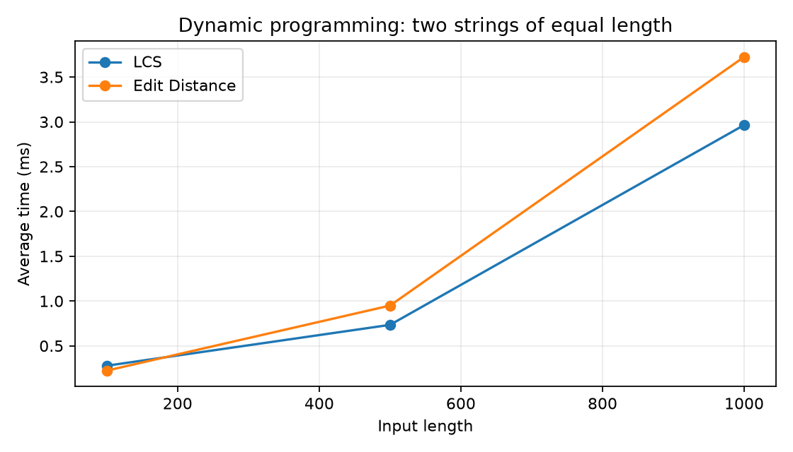
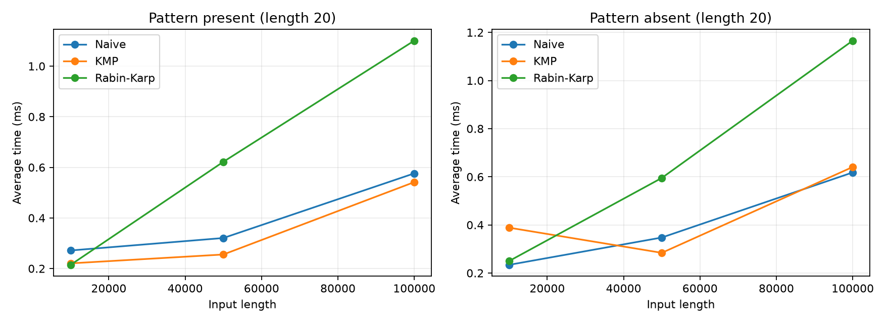
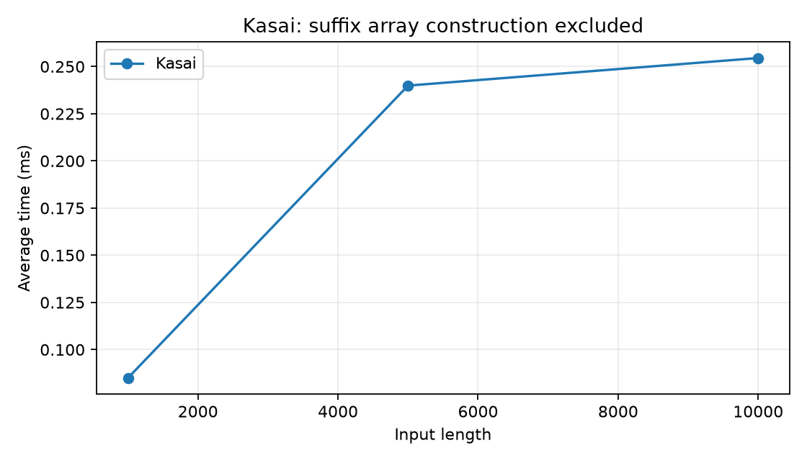

# Assignment 4 — Text Analysis

Проект на Java для сравнения алгоритмов работы со строками. Здесь реализованы LCS, расстояние Левенштейна, наивный поиск, KMP, Rabin–Karp и алгоритм Касаи. Код написан без сторонних Java-библиотек. Этот README является полным отчётом.

## 1. Запуск проекта

Нужен JDK версии 8 или новее. JRE недостаточно, потому что для компиляции требуется `javac`. Команды выполняются из корня проекта:

```text
mkdir out
javac -encoding UTF-8 -d out src/*.java
java -cp out AlgorithmTests
java -cp out Benchmark
```

В PowerShell, если JDK установлен, но не добавлен в PATH, можно указать путь к нему. На компьютере, где выполнялись эксперименты:

```powershell
$jdkPath = "$env:USERPROFILE\.jdks\openjdk-25.0.2\bin"
New-Item -ItemType Directory -Force out | Out-Null
& "$jdkPath\javac.exe" -encoding UTF-8 -d out src\*.java
& "$jdkPath\java.exe" -cp out AlgorithmTests
& "$jdkPath\java.exe" -cp out Benchmark
```

Готовые графики уже находятся в `results`. Для их повторного построения нужен Python и matplotlib:

```text
python -m pip install -r requirements.txt
python scripts/plot_results.py
```

Скрипт также обновляет таблицу результатов ниже. После новых замеров обсуждение результатов нужно проверить вручную, поскольку оно относится к сохранённому запуску.

Структура проекта:

```text
src/DynamicProgramming.java  — LCS и Edit Distance
src/StringMatching.java     — Naive, KMP, Rabin–Karp
src/Kasai.java              — LCP и вспомогательное построение suffix array
src/AlgorithmTests.java     — тесты
src/Benchmark.java          — генерация данных и замеры
scripts/plot_results.py     — графики и таблица отчёта
results/                   — CSV, графики и параметры среды
```

## 2. Алгоритмы и объяснение корректности

### LCS — наибольшая общая подпоследовательность

Подпоследовательность сохраняет порядок символов, но символы не обязаны идти подряд. Например, `ac` — подпоследовательность `abc`. Метод возвращает только длину LCS.

Пусть `dp[i][j]` — длина LCS для первых `i` символов строки `a` и первых `j` символов строки `b`.

```text
dp[0][j] = 0
dp[i][0] = 0

если a[i-1] == b[j-1]:
    dp[i][j] = dp[i-1][j-1] + 1
иначе:
    dp[i][j] = max(dp[i-1][j], dp[i][j-1])
```

У пустой строки нет общей непустой подпоследовательности с другой строкой. Если последние символы совпадают, их можно добавить к ответу для более коротких префиксов. Если они разные, общая подпоследовательность не может использовать оба этих символа как последний символ: нужно исключить последний символ хотя бы одной строки. Выбираем лучший из двух вариантов. Таблица заполняется от коротких префиксов к длинным, поэтому необходимые значения уже известны.

### Edit Distance — расстояние Левенштейна

Это минимальное число вставок, удалений и замен для превращения одной строки в другую. Каждая операция стоит 1, совпадение стоит 0.

```text
dp[i][0] = i
dp[0][j] = j
cost = 0 при a[i-1] == b[j-1], иначе 1
dp[i][j] = min(
    dp[i-1][j] + 1,       // удалить
    dp[i][j-1] + 1,       // вставить
    dp[i-1][j-1] + cost   // заменить или оставить
)
```

Чтобы получить пустую строку, нужно удалить все символы. Чтобы из пустой строки получить другую, нужно вставить все её символы. В общем случае рассматриваются все варианты последнего шага. Для каждого варианта берётся оптимальный ответ для меньших префиксов. Минимум из этих вариантов даёт оптимальный ответ для текущей пары префиксов.

### Наивный поиск

Алгоритм проверяет каждую допустимую стартовую позицию. Внутри позиции символы сравниваются слева направо до несовпадения или конца образца. Если совпали все символы, индекс добавляется в список. Проверяются все возможные позиции, поэтому ни одно вхождение не пропускается.

### KMP

Сначала строится массив `lps`. Значение `lps[i]` — длина наибольшего собственного префикса образца, который одновременно является суффиксом его части `pattern[0..i]`. Собственный префикс не равен всей этой части.

При несовпадении KMP использует уже найденное совпадение: присваивает `j = lps[j-1]`. Эта длина показывает, какую часть образца можно оставить совпавшей. Если вариант снова не подходит, алгоритм переходит к следующему, более короткому префиксу. Индекс текста назад не двигается. Это убирает повторную проверку целых участков текста. После полного совпадения также используется `lps`, поэтому пересекающиеся вхождения сохраняются.

### Rabin–Karp

Для образца и окна текста вычисляется полиномиальный хеш. Основание равно 257, модуль — 1 000 000 007. Переменные типа `long` позволяют безопасно выполнять промежуточные вычисления при этих константах.

При сдвиге окна удаляется вклад первого символа, оставшаяся часть умножается на основание и добавляется новый символ. Поэтому пересчёт хеша занимает O(1).

```text
nextHash = ((oldHash - firstChar * base^(m-1)) * base + nextChar) mod modulus
```

В коде остаток после вычитания приводится к неотрицательному значению. Равные строки обязательно имеют одинаковые хеши, но одинаковые хеши могут быть и у разных строк. Поэтому при равенстве хешей выполняется посимвольная проверка. Коллизии могут замедлить поиск, но не создают ложных ответов. В тестах используется модуль 2, чтобы коллизии возникали часто.

### Алгоритм Касаи

Суффикс — часть строки от некоторой позиции до конца. Суффиксный массив `sa` хранит начальные позиции всех суффиксов в лексикографическом порядке.

Здесь `lcp[0] = 0`, а `lcp[r]` — длина общего префикса суффиксов, начинающихся в `sa[r-1]` и `sa[r]`.

Ручной пример для `banana`:

| r | sa[r] | Суффикс | lcp[r] |
|---:|---:|---|---:|
| 0 | 5 | a | 0 |
| 1 | 3 | ana | 1 |
| 2 | 1 | anana | 3 |
| 3 | 0 | banana | 0 |
| 4 | 4 | na | 0 |
| 5 | 2 | nana | 2 |

Сначала строится обратный массив `rank`: он показывает место каждого суффикса в `sa`. Затем суффиксы перебираются в порядке их позиций в исходной строке. Каждый сравнивается со своим предыдущим соседом в `sa`.

Если у двух суффиксов совпали первые `h` символов, после удаления первых символов остаются хотя бы `h-1` общих символов. Для нового суффикса его непосредственный предыдущий сосед в отсортированном массиве имеет общий префикс не короче этой границы. Поэтому сравнение можно продолжить с `h-1`, не проверяя начало заново. Для самого первого суффикса в порядке `sa` предыдущего соседа нет, и `h` сбрасывается в 0.

Счётчик `h` обычно уменьшается максимум на 1 за итерацию; сброс для `rank == 0` возможен только один раз и не превышает n. Значит, суммарное число увеличений `h` тоже O(n). Вместе с построением `rank` алгоритм работает за O(n).

## 3. Решения и допущения

- Индексы начинаются с 0. Все вхождения, включая пересекающиеся, возвращаются по порядку.
- Пустой образец совпадает на всех границах строки: от 0 до n включительно. Если обе строки пустые, ответ — `[0]`.
- Если образец длиннее текста, возвращается пустой список.
- Входные строки не должны быть `null`. Сравнение учитывает регистр.
- Java `char` означает кодовую единицу UTF-16. Для букв алфавита `abcd` это соответствует одному символу; для некоторых emoji один видимый символ занимает две позиции.
- Динамическое программирование использует полную таблицу. Это проще объяснить, хотя память можно сократить, оставляя только предыдущую и текущую строки.
- Касаи получает корректный, уже отсортированный суффиксный массив без повторяющихся индексов. Проверяется его длина, но полная проверка корректности входного массива не выполняется.
- Для экспериментов суффиксный массив строится простой сортировкой индексов с прямым сравнением суффиксов. Это разрешённый вспомогательный метод, а не реализация быстрого построения SA. В худшем случае он требует O(n² log n) времени и O(n) дополнительной памяти. Его время не входит в замер Касаи.

## 4. Теоретическая сложность

Для динамического программирования n и m — длины двух строк. Для поиска n — длина текста, m — длина образца. В таблице поиска предполагается `1 <= m <= n`; `q = n-m+1` — число возможных стартовых позиций. Память указана без входных данных и возвращаемого результата.

| Алгоритм | Основная операция | Подготовка | Лучший случай | Худший случай | Доп. память | Объяснение |
|---|---|---|---|---|---|---|
| LCS | Совпадение: диагональ + 1; иначе max двух соседей | O(n+m) для границ, входит в общее время | O(nm) | O(nm) | O(nm) | Заполняются все n·m ячеек независимо от символов |
| Edit Distance | min удаления, вставки и замены | O(n+m) для границ, входит в общее время | O(nm) | O(nm) | O(nm) | В каждой ячейке постоянное число действий |
| Naive | Посимвольная проверка каждой позиции | O(1) | Θ(q), несовпадение сразу | O(qm) | O(1) | До m сравнений на одну позицию |
| KMP | Переходы по lps | Θ(m), память O(m) | Θ(n) поиск | O(n) поиск; O(n+m) вместе | O(m) | Текст не просматривается заново с начала совпадения |
| Rabin–Karp | Rolling hash и проверка равных хешей | Θ(m) | Θ(q) поиск без проверок длинных совпадений | O(qm) поиск; O(m+qm) вместе | O(1) | Каждое равенство хешей может потребовать m сравнений |
| Kasai | Сравнение соседних суффиксов с переносом h-1 | Θ(n) для rank, входит в общее время | Θ(n) | Θ(n) | O(n) | Число увеличений h за весь проход линейное |

Для LCS и Edit Distance более точная оценка с учётом пустых строк и выделения таблицы — O((n+1)(m+1)).

Для Rabin–Karp ожидаемое время часто записывают как O(n+m), если коллизии редки и настоящих совпадений мало. Более точная оценка этой реализации — O(n+m+(k+c)m), где k — число настоящих совпадений, c — число ложных совпадений хеша. На повторяющемся тексте настоящих совпадений может быть много, и проверки сами приводят к квадратичному времени. Фиксированный хеш не гарантирует линейное время для любых входов.

Список из k найденных позиций занимает O(k) памяти дополнительно к оценке в таблице. Для пустого образца все три метода тратят Θ(n+1) времени и памяти на результат. Для образца длиннее текста возвращают результат за O(1). Возвращаемый LCP занимает O(n) памяти.

## 5. Проверка корректности

Тесты запускаются обычным `main`, без JUnit. Проверки выбрасывают `AssertionError` при ошибке, поэтому флаг `-ea` не требуется.

Проверены следующие случаи:

- LCS: одинаковые строки, разные строки, пустая строка с обеих сторон и пример с ответом 4.
- Edit Distance: одинаковые строки, пустая строка с обеих сторон, отдельная вставка, удаление, замена и `kitten → sitting` с ответом 3.
- Поиск: вхождение в начале, середине и конце; несколько вхождений; пересечения; отсутствие; слишком длинный образец; пустые текст и образец.
- Каждый тест поиска сравнивает ответы всех трёх алгоритмов с одним ожидаемым списком. Отдельно проверяется Rabin–Karp с частыми коллизиями.
- Касаи: вручную проверенный пример `banana`, пустая строка, один символ и строка `aaaa`.
- Ещё 200 случайных примеров с seed 7: поиск сравнивается с независимой проверкой через стандартный `startsWith`, LCP — с прямым сравнением каждой пары соседних суффиксов. Библиотечная проверка используется только в тестах.

Фактический результат запуска: **PASS: 4670 checks**. Это число отдельных проверок, а не число независимых наборов входных данных. Перед замерами поиска также проверяется совпадение результатов трёх алгоритмов.

## 6. Условия эксперимента

Сохранённые результаты получены на Windows 11, OpenJDK 25.0.2, amd64. JVM видит 12 логических процессоров. Дополнительная информация записана в [environment.txt](results/environment.txt).

Генератор — `java.util.Random`, seed 42. Алфавит для всех случайных строк — `abcd`. В одном запуске генератор используется последовательно, поэтому для воспроизведения тех же данных нужно запускать весь `Benchmark`.

Размеры строго соответствуют заданию:

- LCS и Edit Distance: две строки одинаковой длины 100, 500 и 1000. Оба алгоритма получают одну и ту же пару для каждого размера.
- Поиск: текст длины 10 000, 50 000 и 100 000; длина образца всегда 20. Присутствующий образец берётся из середины текста. Отсутствующий генерируется из того же алфавита и проверяется до замера. На каждом размере все три метода получают одинаковые текст и образец для каждого случая.
- Касаи: строки длины 1000, 5000 и 10 000. Суффиксный массив строится до замера.

Для каждого сочетания алгоритма, размера и случая выполняются 10 прогревочных запусков, затем ровно 5 измеряемых. Среднее — сумма пяти длительностей, делённая на 5. Измерение выполняется через `System.nanoTime()`.

Генерация входных данных, проверки ответов, вывод и запись файлов находятся вне измеряемых участков. Время включает выполнение метода, выделение его рабочих массивов и результата. Для KMP включено построение LPS, для Rabin–Karp — начальных хешей. Поэтому график поиска показывает полный вызов метода. Результат сохраняется в `volatile`-поле после замера, чтобы оставаться наблюдаемым для JVM.

Счётчики учитывают сравнения символов; для KMP отдельно учитывается подготовка LPS. Счётчики встроены в измеряемый код. В Rabin–Karp они не учитывают арифметику хеша и сравнения числовых хешей. Поэтому ноль сравнений символов не означает отсутствие работы. На одинаковых входах счётчики повторяются, в таблице записано значение одного запуска.

Все пять отдельных длительностей доступны в [raw.csv](results/raw.csv), средние — в [averages.csv](results/averages.csv).

## 7. Результаты

*Результат: для LCS — длина подпоследовательности; для Edit Distance — расстояние; для поиска — число вхождений; для Касаи — длина LCP-массива. `random` означает случайные строки, `present` — образец присутствует, `absent` — отсутствует. Прочерк означает, что счётчик для этого алгоритма не собирался.*

<!-- RESULTS START -->

| Алгоритм | n | Случай | Среднее, мс | Сравнения подготовки | Сравнения поиска | Результат* |
|---|---:|---|---:|---:|---:|---:|
| LCS | 100 | random | 0.278100 | — | — | 64 |
| Edit Distance | 100 | random | 0.223280 | — | — | 55 |
| LCS | 500 | random | 0.734160 | — | — | 326 |
| Edit Distance | 500 | random | 0.949340 | — | — | 267 |
| LCS | 1000 | random | 2.964460 | — | — | 648 |
| Edit Distance | 1000 | random | 3.724860 | — | — | 521 |
| Naive | 10000 | present | 0.271480 | 0 | 13353 | 1 |
| KMP | 10000 | present | 0.220560 | 25 | 12446 | 1 |
| Rabin-Karp | 10000 | present | 0.214620 | 0 | 20 | 1 |
| Naive | 10000 | absent | 0.234020 | 0 | 13283 | 0 |
| KMP | 10000 | absent | 0.388540 | 22 | 12537 | 0 |
| Rabin-Karp | 10000 | absent | 0.249780 | 0 | 0 | 0 |
| Naive | 50000 | present | 0.320700 | 0 | 66588 | 1 |
| KMP | 50000 | present | 0.255540 | 22 | 61663 | 1 |
| Rabin-Karp | 50000 | present | 0.621900 | 0 | 20 | 1 |
| Naive | 50000 | absent | 0.347580 | 0 | 66547 | 0 |
| KMP | 50000 | absent | 0.283960 | 21 | 62455 | 0 |
| Rabin-Karp | 50000 | absent | 0.595180 | 0 | 0 | 0 |
| Naive | 100000 | present | 0.576160 | 0 | 132854 | 1 |
| KMP | 100000 | present | 0.541620 | 26 | 124272 | 1 |
| Rabin-Karp | 100000 | present | 1.100740 | 0 | 20 | 1 |
| Naive | 100000 | absent | 0.618000 | 0 | 133113 | 0 |
| KMP | 100000 | absent | 0.640700 | 21 | 124764 | 0 |
| Rabin-Karp | 100000 | absent | 1.165780 | 0 | 0 | 0 |
| Kasai | 1000 | random | 0.084940 | — | — | 1000 |
| Kasai | 5000 | random | 0.239900 | — | — | 5000 |
| Kasai | 10000 | random | 0.254520 | — | — | 10000 |

<!-- RESULTS END -->







## 8. Обсуждение

У LCS при увеличении длины с 500 до 1000 время выросло примерно с 0,73 до 2,96 мс, то есть примерно в 4 раза. У Edit Distance — с 0,95 до 3,72 мс. Это согласуется с квадратичной сложностью: при удвоении обеих длин число ячеек увеличивается в четыре раза. Переход от 100 к 500 не даёт идеального отношения 25: на малых замерах заметны прогрев JVM и постоянные затраты.

На случайном тексте наивный поиск оказался конкурентоспособным. Для 100 000 символов и присутствующего образца он выполнил 132 854 сравнения, KMP — 124 272 сравнения поиска. Случайные символы часто различаются уже в начале проверки, поэтому наивный алгоритм редко сравнивает весь образец. Его плохой теоретический случай здесь почти не встречается. Кроме того, m фиксировано: даже верхняя граница O(nm) при постоянном m растёт линейно по n. Эти эксперименты не демонстрируют худший случай наивного алгоритма.

KMP даёт гарантию O(n+m), но не обязан быть самым быстрым на каждом входе. Например, для отсутствующего образца при n = 100 000 он занял около 0,64 мс, а наивный поиск — 0,62 мс. Такая небольшая разница не позволяет объявить один алгоритм универсально быстрее другого.

Rabin–Karp при n = 100 000 занял около 1,10–1,17 мс. При этом он выполнил только 20 сравнений символов в случае присутствия образца и 0 в случае отсутствия. Причина в том, что основная работа приходится на вычисление rolling hash, включая операции по модулю. Малое число сравнений символов не гарантирует малое время.

У Касаи рост времени не был строго пропорционален размеру: получено примерно 0,085, 0,240 и 0,255 мс. Эти очень короткие замеры зависят от оптимизации JVM и состояния компьютера. Они не опровергают линейную оценку, но и не доказывают её: оценка следует из анализа алгоритма. Построение суффиксного массива здесь исключено, поэтому график нельзя считать временем всего процесса «строка → LCP».

Ограничения эксперимента: одна пара строк на размер, короткий фиксированный образец, один запуск JVM, фиксированный порядок алгоритмов и только пять измерений после прогрева. Влияние сборки мусора, фоновых процессов и JIT не исключено. Результаты показывают поведение этой реализации на этих данных; на другой машине числа будут отличаться.

## 9. Вывод

LCS подходит для поиска общей подпоследовательности, а Edit Distance — для оценки числа изменений между строками. Оба метода понятны через таблицу, но требуют квадратичной памяти при равных длинах.

Наивный поиск проще всего реализовать и может быть быстрым на случайных данных. KMP требует массив LPS, зато гарантирует линейное время вместе с подготовкой. Rabin–Karp использует хеши и мало сравнивает символы, но зависит от стоимости хеширования, коллизий и количества совпадений. Касаи строит LCP за линейное время, когда суффиксный массив уже готов.

## 10. Сдача

Нужно разместить этот проект в своём репозитории GitHub и отправить ссылку через Moodle. Сам код, тесты, полный отчёт, исходные результаты и три графика находятся в проекте. Публикация в GitHub и отправка в Moodle автоматически не выполнялись.
